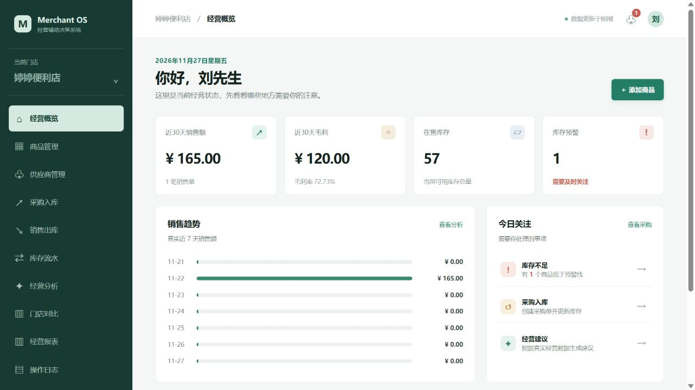
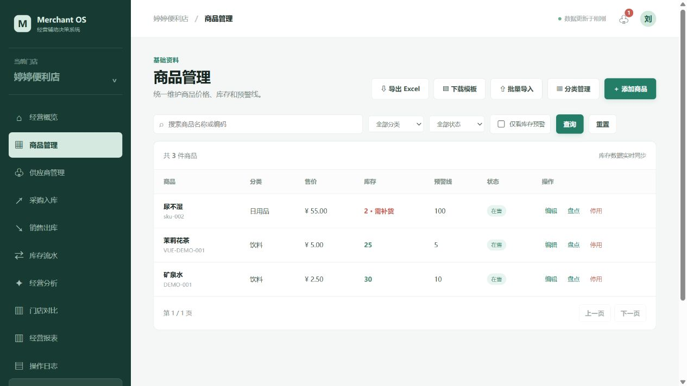
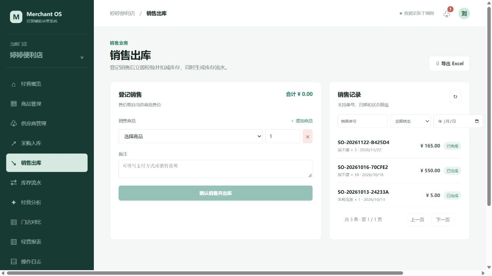
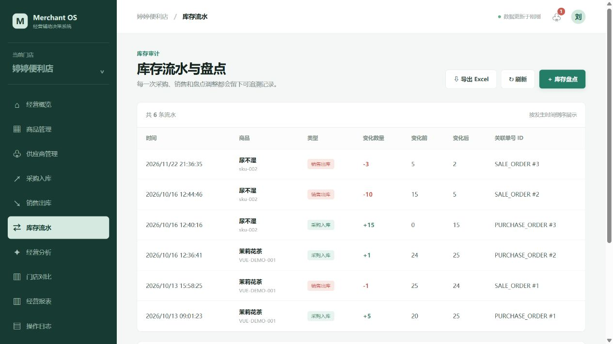
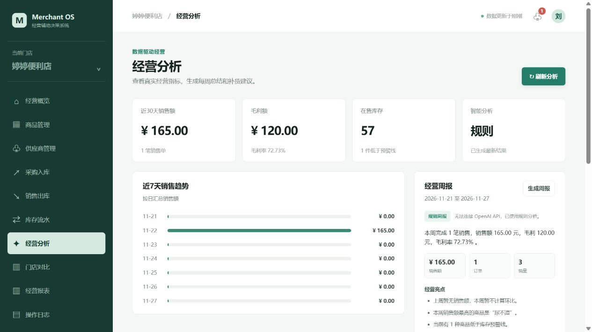
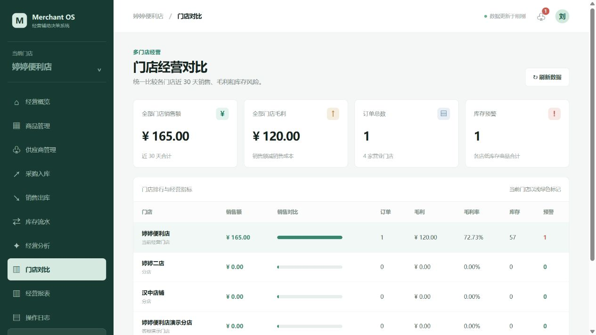

# 中小商户进销存与经营辅助决策系统

题目：基于大语言模型的中小商户进销存与经营辅助决策系统设计与实现。

系统采用 Spring Boot、Vue 3 和 PostgreSQL 的前后端分离架构，已打通商品、供应商、采购、销售、库存流水、多门店、经营报表、智能分析和账号安全等核心流程。业务系统负责计算和保存事实数据，大语言模型只负责生成经营说明与建议。


## 项目截图

| 经营概览 | 商品管理 |
|---|---|
|  |  |

| 销售出库 | 库存流水 |
|---|---|
|  |  |

| 经营分析 | 多门店对比 |
|---|---|
|  |  |

## 核心功能

- 商品、分类与供应商资料管理
- 采购入库、销售出库与库存不足校验
- 库存流水、盘点调整与全过程追溯
- 多门店数据隔离、门店切换与经营对比
- 销售额、成本、毛利、排行与库存预警报表
- 经营周报与智能补货建议，模型不可用时自动使用本地规则
- 管理员与店员权限、操作日志、注册及密码找回
- Excel 批量导入导出、数据备份与 Docker Compose 一键部署

## 技术栈

| 层级 | 技术 |
|---|---|
| 前端 | Vue 3、Vite、JavaScript、CSS |
| 后端 | Java 17、Spring Boot、Spring Data JPA、REST API |
| 数据库 | PostgreSQL、H2（测试） |
| 智能分析 | OpenAI API、结构化提示词、本地规则降级 |
| 工程化 | Maven、Docker、Docker Compose、Nginx |
| 测试 | JUnit 5、Spring MockMvc |

PostgreSQL 数据目录是项目下的 `data\postgres`，也位于 E 盘。该目录已加入忽略规则，正式数据不要提交到代码仓库。

前端目录是 `frontend`。安装 Node.js 后，在该目录执行 `npm.cmd install`，再执行 `npm.cmd run dev`，访问 `http://localhost:5173`。开发服务器会把 `/api` 请求转发到 Spring Boot 的 `http://localhost:8080`。

## 运行

### Docker 一键运行

双击桌面上的“婷婷便利店”快捷方式即可启动。快捷方式会自动打开 Docker Desktop（如果尚未运行）、等待 Docker 引擎就绪、启动项目并打开 `http://127.0.0.1:5173/`。也可以双击项目根目录的 `启动项目.bat`。停止服务请运行 `停止项目.bat`；它只停止容器，不会删除数据库数据。

首次运行或更新容器镜像时，在 PowerShell 执行 `docker compose up -d --build`。日常启动使用 `docker compose up -d` 即可。

### 数据备份

项目运行时双击 `备份数据库.bat`，或在 PowerShell 执行 `powershell.exe -NoProfile -ExecutionPolicy Bypass -File .\scripts\backup-database.ps1`。备份文件保存在 `data\backups`，不会提交到代码仓库。

备份是 PostgreSQL 的普通 SQL 导出。不要直接导入当前正在使用的非空数据库，否则可能遇到表或数据冲突。恢复前先运行一次新的备份，并确保目标数据库为空；恢复步骤会替换数据库内容，建议在确认备份文件和目标库后再执行。

### 开发模式

在开发模式下单独启动数据库：

```bash
docker compose up -d postgres
```

### 2. 启动后端

在 IDEA 中以 Maven 项目导入 `pom.xml`，运行 `MerchantAssistantApplication`，或者执行：

```bash
mvn spring-boot:run
```

服务默认运行在 `http://localhost:8080`。

### 3. 测试商品接口

```bash
curl -X POST http://localhost:8080/api/products ^
  -H "Content-Type: application/json" ^
  -d "{\"sku\":\"SKU-001\",\"name\":\"矿泉水\",\"category\":\"饮料\",\"purchasePrice\":1.50,\"sellingPrice\":2.50,\"stock\":30,\"stockWarningLine\":10}"

curl "http://localhost:8080/api/products?keyword=矿泉"
```

## 当前接口

| 方法 | 地址 | 说明 |
|---|---|---|
| GET | `/api/products` | 查询商品，可用 `keyword` 搜索名称或编码 |
| GET | `/api/products/{id}` | 查询商品详情 |
| POST | `/api/products` | 新增商品 |
| PUT | `/api/products/{id}` | 修改商品 |
| DELETE | `/api/products/{id}` | 停用商品（软删除） |

## 第六阶段：登录、角色与操作日志

正式运行默认开启登录校验。首次启动会自动创建两个演示账号：

- 管理员：`admin / admin123`，可以查看操作日志、停用商品/供应商和取消采购单。
- 店员：`clerk / clerk123`，可以进行商品维护、采购入库、销售出库和经营分析，但不能执行管理员操作。

登录成功后前端把会话令牌保存在浏览器本地，并在请求头中发送 `X-Session-Token`。关键写操作会写入 `operation_logs` 表，管理员可以从前端“操作日志”页面查看最近 100 条记录。

测试 profile 为了保持原有 MockMvc 业务测试简洁，使用 `app.security.enabled: false`；正式环境不要关闭该配置。当前会话存储在后端内存中，适合单体毕设演示，后续部署多实例时可替换为 Redis 或 Spring Session。

## 第七阶段：经营报表

“经营报表”页面支持按日期范围查询订单数、销售数量、销售额、成本、毛利和毛利率，并按商品汇总销量与销售额。日期范围最长一年，默认查询最近 30 天。

- `GET /api/reports/sales?from=2026-10-01&to=2026-10-31`：查询销售报表。
- `GET /api/reports/sales/export?from=2026-10-01&to=2026-10-31`：导出 UTF-8 CSV，兼容 Windows Excel 中文显示。

## 第八阶段：真实经营概览

首页通过 `GET /api/analytics/overview` 展示真实经营数据，包括近 30 天销售额、毛利、毛利率、在售库存、库存预警和近 7 天销售趋势。首页日期取系统当前日期，经营建议入口可直接进入经营分析页面。

## 第九阶段：用户管理与账户安全

系统使用 BCrypt 保存密码，并兼容已有 SHA-256 密码；旧密码首次登录成功后会自动升级为 BCrypt。会话默认有效期为 120 分钟，修改密码、管理员重置密码或停用账号后，相关旧会话立即失效。

所有用户都可以在“用户与安全”页面修改自己的密码。管理员还可以创建管理员或店员账号、启用或停用账号以及重置密码。`/api/users/**` 仅允许管理员访问。

| 方法 | 地址 | 说明 |
|---|---|---|
| POST | `/api/auth/change-password` | 修改当前账号密码 |
| GET | `/api/users` | 查询系统用户（管理员） |
| POST | `/api/users` | 创建系统用户（管理员） |
| PUT | `/api/users/{id}/status` | 启用或停用用户（管理员） |
| POST | `/api/users/{id}/reset-password` | 重置用户密码（管理员） |

## 第十阶段：AI 经营周报与补货建议

“经营分析”页面新增两个面向日常经营的功能：

- 经营周报：汇总最近 7 天与前 7 天的销售额、订单数、销量、毛利和毛利率，生成经营亮点与下周行动。
- 智能补货：根据近 30 天销量、库存预警线和 14 天覆盖周期计算建议补货数量及预计采购成本。系统只生成建议，不会自动创建采购单或修改库存。

两项功能优先由后端固定统计数据计算，OpenAI 只负责结构化总结和表达，不能执行 SQL、修改库存或改变系统计算出的补货数量。调用失败时会返回具体原因并自动使用规则结果，页面会显示“AI 已生成”或“规则分析”及降级说明。

新增接口：

| 方法 | 地址 | 说明 |
|---|---|---|
| POST | `/api/analytics/weekly-report` | 生成经营周报 |
| POST | `/api/analytics/replenishment` | 计算补货建议 |

OpenAI 配置通过环境变量提供：`OPENAI_API_KEY`、`OPENAI_API_URL` 和 `OPENAI_MODEL`。当前机器若无法访问 `api.openai.com`，系统仍可使用规则分析完成演示。
